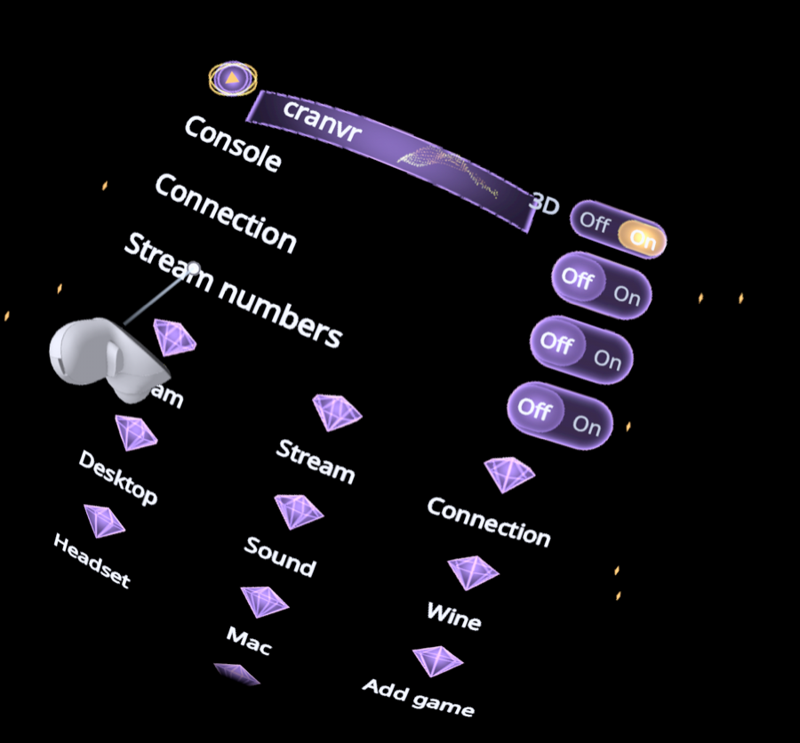
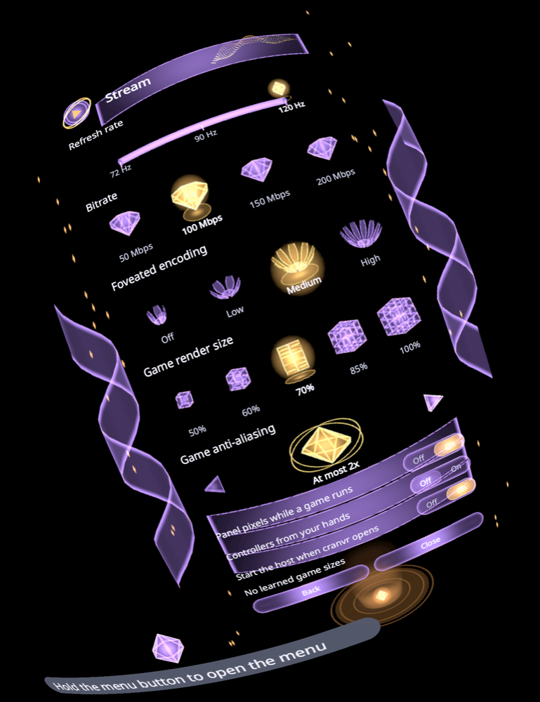

# cranvr

https://github.com/user-attachments/assets/8c58fbfc-4ba8-43ad-a4a8-9bc6d51156b0

cranvr plays Windows VR games from Steam on a Meta Quest 3. The games run on an Apple Silicon Mac. The headset shows them as a stream over Wi-Fi or a USB cable. The headset can also show the Mac's displays as panels.

  
  

## What you need

- A Mac with Apple Silicon and macOS 14.2 or newer.
- A Meta Quest 3.
- Wi-Fi on 5 GHz or 6 GHz for the Mac and the headset, or a USB cable between them.
- A Steam account with the games.

## Install

1. Download the newest `cranvr-*.dmg` from [Releases](https://github.com/samoylenkodmitry/cranvr/releases). Open it. Drag cranvr to Applications.
2. Download `cranvr-client-*.apk` from the same release. Install it on the headset with `adb install` or SideQuest. This step needs Developer Mode on the headset.
3. Open cranvr on the Mac. macOS asks for Screen Recording, System Audio Recording and Accessibility. Allow all three. The game sound needs System Audio Recording. Accessibility lets a controller work as the Mac's mouse.

## Connect the headset

1. Open cranvr on the headset. It is in the app library under Unknown Sources.
2. The headset lists the Macs that run cranvr. Press your Mac.
3. The first time, the headset and the Mac show a code of six digits. Press Allow on the Mac when the two codes match.

With a USB cable, the headset lists "This Mac by USB cable" first. The first time, macOS asks "Allow accessory to connect?". Click Allow.

## Play a game

1. In the Mac window, open the Play tab. Press "Set up games". It installs Rosetta 2, the game support (Wine and the VR runtime) and Steam for Windows. macOS asks for your password for Rosetta 2.
2. Sign in to Steam in the Steam window. Install a game there.
3. Press Play next to the game in the Play tab. The hand menu in the headset starts games too.

Beat Saber and Serious Sam VR: The Last Hope run. Other Steam VR games may run. cranvr never bypasses anti-cheat: a game whose anti-cheat refuses Wine does not run.

## In the headset

- Hold the left controller's menu button or B to open the hand menu. A press on the ball above the left controller opens it too. The menu shows or hides the panels, starts games and opens the settings.
- The Mac's displays show as panels. Point at a panel to move the Mac's mouse. Pull the trigger to click. Push the thumbstick to scroll.
- Point at the handle under a panel and hold the trigger to move the panel.
- With your hands and no controller, touch a button, the ball, the gem or a display's panel with your index fingertip to press it. A touch on a display clicks the Mac's mouse at that point. From farther away, point with your hand and pinch.

## Record what you see

Press the gem above your left hand to start a recording. The gem glows red while it records. Press it again to stop. The hand menu and the Mac window have a "Record what I see" button too. The video goes to `~/Movies/cranvr` on the Mac, with the game sound. Recording needs the USB cable and Developer Mode on the headset.

## Build from source

[docs/README.md](docs/README.md) lists the developer documentation: the build, the parts, the protocol, the games and the tests. [AGENTS.md](AGENTS.md) holds the rules for work on the code.

## License

Choose [Apache-2.0](LICENSE) or [MIT](LICENSE-MIT). Third-party code keeps its own license:

- cranvr's patches of Wine in `third_party/wine/` fall under Wine's LGPL 2.1 (`third_party/licenses/LGPL-2.1.txt`).
- The OpenVR headers in `steamvr/openvr/` keep Valve's license (`steamvr/openvr/LICENSE`).
- The foveation math follows ALVR v20.14.1 (MIT, `third_party/licenses/ALVR-MIT.txt`). BasaltVR is MIT.
- The game support download carries [OpenComposite](https://gitlab.com/znixian/OpenOVR) (GPL 3) as a separate program. The GPL covers it and cranvr's patches of it in `third_party/opencomposite/`. Each release of [cranvr-game-support](https://github.com/samoylenkodmitry/cranvr-game-support) carries its source and its license.
